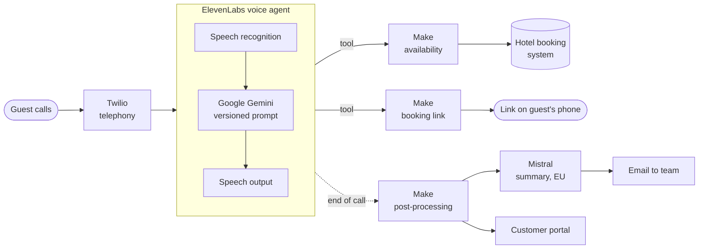

<h1 align="center">AI Phone Agent, Hotel Nanis</h1>

  Answers calls when the front desk is unavailable, checks live room availability 
  and sends the booking link to the caller's phone.

  
  
  
  
  
  

<a href="README.md">Deutsch</a> · <b>English</b>

---

## What is it about?

A small hotel does not have a front desk around the clock. Calls in the evening, at the weekend
or during check-in go unanswered, and bookings get lost with them.

The phone agent takes exactly these calls. It introduces itself as an AI assistant, answers
questions about the hotel, checks live which rooms are free for the requested dates and, on
request, sends the booking link to the caller. Anything a person needs to handle reaches the
team as a summary.

## How a call works

## What the agent does

- **Answers questions** about rooms, breakfast, arrival and the area, from a curated knowledge base
- **Checks live availability** through the booking system's API, including requests for several
  rooms: first one suitable room type, otherwise a combination of two types
- **Sends the booking link** so the guest books directly with the hotel
- **Five languages:** German, English, French, Spanish, Greek, with automatic detection
- **Takes a callback request** when the caller prefers to speak to a person

## What it deliberately does not do

| Guardrail | Reason |
|---|---|
| No prices without a prior live check | No invented figures |
| Booking link only after a confirmed availability check | No link for fully booked dates |
| No binding booking on the phone | The guest completes the booking |
| Several rooms only with a confirmed number | Commitments rely on the booking system's value |

## Quality assurance

- **Automatic evaluation of every call** against four criteria: request resolved, no hallucination,
  no looping AI disclaimer, correct end of call
- **Prompt versioned in Git.** Every release is compared with the live configuration after rollout
- **Test calls before every release**, with defined acceptance criteria
- **Review of real calls:** in September 2026 all 257 transcripts with content were read, and the
  next prompt version was built from the findings
- **Response time** averaged about 2.3 seconds in one measured test call

## Privacy and EU AI Act

| Principle | Implementation |
|---|---|
| Transparency | The agent introduces itself as an AI assistant at the start |
| No audio recording | Only the transcript is stored, not the voice |
| Storage limitation | Transcripts are deleted automatically after 90 days |
| Processing in the EU | The post-call summary runs on Mistral in Paris |
| Role under the EU AI Act | Deployer of established AI platforms, no own model |

## Building blocks

| Task | Service |
|---|---|
| Voice dialogue | ElevenLabs Conversational AI |
| Language model during the call | Google Gemini |
| Telephony | Twilio |
| Availability and booking link | Make, API of the hotel's booking system |
| Post-call summary | Mistral (EU) |
| Email to the team | Brevo |
| Reporting for the hotel | own [customer portal](https://github.com/pnanis-alt/kunden-portal/blob/main/README.en.md) |

## How it was built

Concept, conversation design, architecture, privacy and acceptance testing are mine. The
implementation is AI-assisted with Claude Code: scenarios, prompt versions and test scripts are
created in dialogue, every change is checked before rollout and recorded in Git.

## Try it live

A test call with a demo agent is available at [logik-agentur.de](https://logik-agentur.de)
(German-language website).

---

As of 27 September 2026. Configuration, prompts and knowledge base are private.
Contact: [LinkedIn](https://www.linkedin.com/in/pantelis-nanis) · [Logik-Agentur](https://logik-agentur.de)
