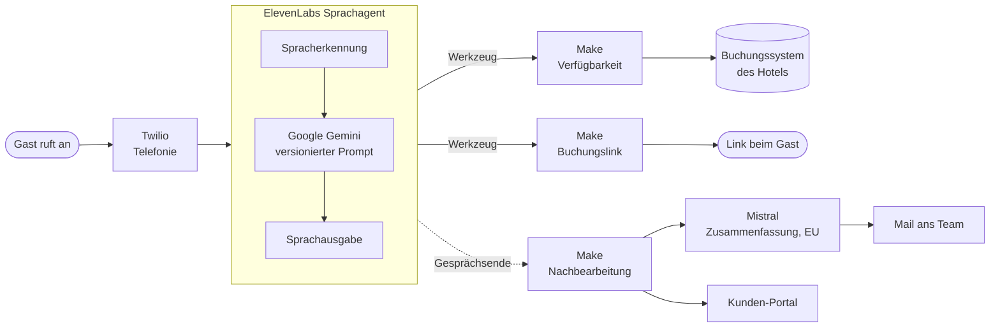

<h1 align="center">KI-Telefonagent Hotel Nanis</h1>

  Nimmt Anrufe an, wenn die Rezeption nicht erreichbar ist, prüft live freie Zimmer 
  und schickt dem Gast den Buchungslink aufs Handy.

  
  
  
  
  
  

<b>Deutsch</b> · <a href="README.en.md">English</a>

---

## Worum geht es?

Ein kleines Hotel hat keine Rezeption rund um die Uhr. Anrufe am Abend, am Wochenende oder
während des Check-ins gehen verloren, und mit ihnen Buchungen.

Der Telefonagent übernimmt genau diese Anrufe. Er meldet sich als KI-Assistent, beantwortet
Fragen zum Hotel, prüft für konkrete Daten live, welche Zimmer frei sind, und schickt dem Gast
auf Wunsch den Buchungslink. Alles, was ein Mensch klären muss, landet als Zusammenfassung
beim Team.

## So läuft ein Anruf

## Was der Agent kann

- **Fragen beantworten** zu Zimmern, Frühstück, Anreise, Umgebung, aus einer gepflegten Wissensbasis
- **Live-Verfügbarkeit prüfen** über die Schnittstelle des Buchungssystems, auch für mehrere Zimmer:
  erst eine passende Zimmerart, sonst eine Kombination aus zwei Arten
- **Buchungslink verschicken**, damit der Gast direkt beim Hotel bucht
- **Fünf Sprachen:** Deutsch, Englisch, Französisch, Spanisch, Griechisch, mit automatischer Erkennung
- **Rückruf aufnehmen**, wenn der Gast lieber mit einem Menschen spricht

## Was er bewusst nicht tut

| Leitplanke | Grund |
|---|---|
| Keine Preise ohne vorherige Live-Prüfung | Keine erfundenen Zahlen |
| Buchungslink nur nach geprüfter Verfügbarkeit | Kein Link für ausgebuchte Tage |
| Keine verbindliche Buchung am Telefon | Die Buchung schließt der Gast selbst ab |
| Mehrere Zimmer nur mit belegter Zahl | Zusagen hängen am Wert aus dem Buchungssystem |

## Qualitätssicherung

- **Automatische Bewertung jedes Gesprächs** nach vier Kriterien: Anfrage gelöst, keine Halluzination,
  kein Endlos-Hinweis auf die KI, korrekter Gesprächsabschluss
- **Prompt in Git versioniert.** Jede Version wird nach dem Ausrollen gegen den Live-Stand abgeglichen
- **Testanrufe vor jeder Freigabe**, mit festgelegten Prüfkriterien
- **Auswertung echter Gespräche:** Im September 2026 wurden alle 257 Transkripte mit Inhalt gelesen,
  daraus entstand die nächste Prompt-Version
- **Antwortzeit** in einem gemessenen Testanruf im Mittel rund 2,3 Sekunden

## Datenschutz und EU AI Act

| Grundsatz | Umsetzung |
|---|---|
| Transparenz | Der Agent stellt sich zu Beginn als KI-Assistent vor |
| Keine Tonaufnahme | Gespeichert wird nur das Transkript, keine Stimme |
| Speicherbegrenzung | Transkripte werden nach 90 Tagen automatisch gelöscht |
| Verarbeitung in der EU | Die Zusammenfassung nach dem Anruf läuft über Mistral in Paris |
| Rolle nach EU AI Act | Betreiber (Deployer) etablierter KI-Plattformen, kein eigenes Modell |

## Bausteine

| Aufgabe | Dienst |
|---|---|
| Sprachdialog | ElevenLabs Conversational AI |
| Sprachmodell im Gespräch | Google Gemini |
| Telefonie | Twilio |
| Verfügbarkeit und Buchungslink | Make, Schnittstelle zum Buchungssystem des Hotels |
| Zusammenfassung nach dem Anruf | Mistral (EU) |
| Mail ans Team | Brevo |
| Auswertung für das Hotel | eigenes [Kunden-Portal](https://github.com/pnanis-alt/kunden-portal) |

## Wie gebaut

Konzept, Gesprächsführung, Architektur, Datenschutz und Abnahme liegen bei mir. Die Umsetzung
erfolgt KI-gestützt mit Claude Code: Szenarien, Prompt-Versionen und Prüfskripte entstehen im
Dialog, jede Änderung wird vor dem Ausrollen geprüft und in Git festgehalten.

## Live ausprobieren

Einen Testanruf mit einem Demo-Agenten gibt es auf [logik-agentur.de](https://logik-agentur.de).

---

Stand: 27.09.2026. Konfiguration, Prompts und Wissensbasis sind privat.
Kontakt: [LinkedIn](https://www.linkedin.com/in/pantelis-nanis) · [Logik-Agentur](https://logik-agentur.de)
